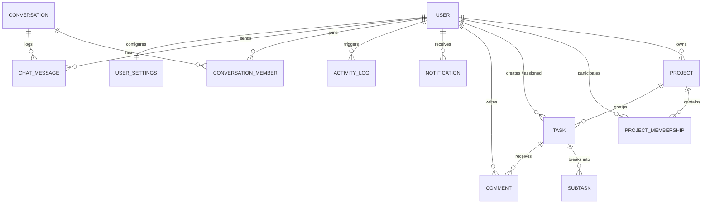
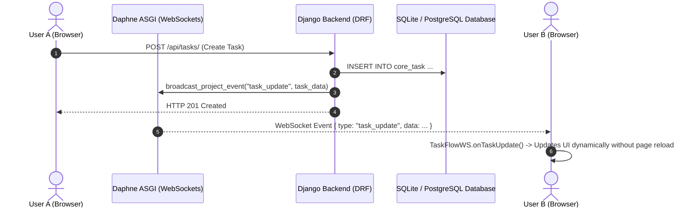

# TaskFlow — Modern Collaborative Project Management Web Application

TaskFlow is a full-stack, enterprise-grade project management application designed to organize collaborative team workspaces, track sprint delivery, manage task lifecycles, and provide real-time notification and chat updates.

This codebase features a clean **3-tier separation** between the Frontend, Backend, and Database layers, built with **Vanilla JavaScript, HTML5, CSS3, Python 3.12+, Django 6.1.1, Django REST Framework, Django Channels (Daphne ASGI WebSockets), and SQLite / PostgreSQL**.

---

## Table of Contents

1. [System Architecture](#1-system-architecture)
2. [Technology Stack](#2-technology-stack)
3. [Preserved UI Design System & Tokens](#3-preserved-ui-design-system--tokens)
4. [Application Modules & Pages](#4-application-modules--pages)
5. [Database Architecture & Schema](#5-database-architecture--schema)
6. [Data Integrity & Deduplication Safeguards](#6-data-integrity--deduplication-safeguards)
7. [Real-Time WebSockets Architecture](#7-real-time-websockets-architecture)
8. [Complete REST API Reference](#8-complete-rest-api-reference)
9. [Windows Installation & Setup Guide](#9-windows-installation--setup-guide)
10. [Automated Test Suite & Verification](#10-automated-test-suite--verification)
11. [Troubleshooting & FAQ](#11-troubleshooting--faq)
12. [Project Checklist & Submission Status](#12-project-checklist--submission-status)

---

## 1. System Architecture

```text
TaskFlow/
├── frontend/                     # Tier 1: HTML5, CSS3, Vanilla JS Client
│   ├── index.html                # 1. Landing / Public Home Page
│   ├── login.html                # 2. Login Page
│   ├── register.html             # 3. Registration Page
│   ├── dashboard.html            # 4. Main Dashboard (Live Metrics & Activity)
│   ├── my-tasks.html             # 5. My Tasks (Table, Kanban, Status/Priority Filters)
│   ├── projects.html             # 6. Projects Directory (Grid & List Views)
│   ├── inbox.html                # 7. Inbox / Messages Hub
│   ├── calendar.html             # 8. Calendar & Schedule Page
│   ├── notifications.html        # 9. Notifications Feed Page
│   ├── task-details.html         # 10. Task Details, Subtasks Checklist & Comments
│   ├── project-details.html      # 11. Project Details, Members & Burndown
│   ├── create-project.html       # 12. Create Project Wizard
│   ├── team-members.html         # 13. Team Members Directory
│   ├── my-profile.html           # 14. User Profile Management
│   ├── settings.html             # 15. Workspace & Account Settings
│   ├── help-support.html         # 16. Help Center & Support Ticket Page
│   ├── team-chat.html            # 17. Real-Time Team Chat Room
│   ├── api.js                    # Unified REST API Client & Auth Singleton
│   ├── websocket.js              # Live WebSocket Real-Time Client Module
│   ├── css/                      # Preserved CSS stylesheets
│   ├── js/                       # Client script modules
│   └── assets/                   # Design graphics, badges, and icons
│
├── backend/                      # Tier 2: Python / Django REST Framework / Channels
│   ├── manage.py                 # Django CLI Utility
│   ├── requirements.txt          # Python Dependencies Manifest
│   ├── .env.example              # Environment Configuration Template
│   ├── audit_database.py         # Standalone Database Integrity & Duplicate Audit
│   ├── test_frontend_endpoints.py# Integration Verification Script
│   ├── config/                   # Django Project Core Configuration
│   │   ├── asgi.py               # ASGI Application Router (HTTP + WebSockets)
│   │   ├── settings.py           # Unified Settings, CORS, Auth, Channels Layer
│   │   ├── urls.py               # Root URL Dispatcher
│   │   └── wsgi.py               # WSGI Web Server Gateway
│   └── core/                     # Application Business Logic App
│       ├── models.py             # Relational Database Models (ORM)
│       ├── serializers.py        # Django REST Framework Serializers
│       ├── views.py              # REST Viewsets & Endpoints
│       ├── urls.py               # API Route Mappings
│       ├── permissions.py        # Object & Role Permissions Classes
│       ├── consumers.py          # WebSocket Notification & Chat Consumers
│       ├── routing.py            # WebSocket URL Patterns
│       ├── services.py           # Notification & Channel Layer Broadcasts
│       ├── admin.py              # Django Admin Interface Registration
│       ├── tests.py              # Automated Unit & Integration Test Suite
│       └── management/commands/  # Management Commands
│           ├── cleanup_duplicates.py  # Safe Duplicate Record Audit & Cleanup
│           └── seed_demo_data.py      # Optional Development-Only Demo Seeder
│
├── database/                     # Tier 3: Database Documentation & Migration
│   ├── SCHEMA.md                 # Entity Relationship & Table Specifications
│   └── README.md                 # Database Setup & PostgreSQL Migration Guide
│
├── README.md                     # Project Master Documentation
└── .gitignore                    # Git Exclusion Configuration
```

---

## 2. Technology Stack

### Frontend Client
* **HTML5 & CSS3**: Semantic markups, accessible forms, flexbox and CSS grid layouts.
* **Vanilla JavaScript (ES6+)**: Zero framework lock-in or heavy virtual DOM overhead.
* **Fetch API**: Centralized `TaskFlowAPI` singleton managing token headers, JSON requests, and unified error handling.
* **WebSocket API**: Native browser WebSocket connection via `TaskFlowWS` with auto-reconnection backoff and LRU event deduplication.

### Backend Application
* **Python 3.12+**
* **Django 6.1.1**: Secure web framework handling routing, models, authentication, and migrations.
* **Django REST Framework (DRF)**: Standardized JSON API endpoints with token authentication and pagination.
* **Django Channels 4 & Daphne 4.2.3**: Asynchronous ASGI server for simultaneous HTTP REST handling and WebSocket bi-directional event streaming.
* **django-cors-headers**: Secure Cross-Origin Resource Sharing allowing separate frontend hosting.

### Database Layer
* **SQLite 3**: Default local development relational database with zero setup requirements.
* **PostgreSQL Ready**: Compatible database schema configured to run with PostgreSQL by updating `.env` database credentials.

---

## 3. Preserved UI Design System & Tokens

All 17 frontend HTML interfaces strictly preserve their original visual designs, component layouts, and design tokens:

| Design Token | CSS Variable / Value | Description |
|---|---|---|
| **Primary Blue** | `#2563EB` | Active buttons, brand accents, links, primary highlights |
| **Dark Navy** | `#172B4D` / `#0F172A` | Sidebar, primary headers, modal titles, high-contrast text |
| **Canvas Background** | `#F5F7FB` | Main workspace background color |
| **Card Background** | `#FFFFFF` | Elevated surface containers and cards |
| **Border Tone** | `#E5EAF2` / `#E2E8F0` | Subtle divider and container borders |
| **Muted Slate** | `#64748B` | Subtitles, metadata tags, secondary timestamps |
| **Success Emerald** | `#10B981` | Completed badges, active indicators, progress bars |
| **Warning Amber** | `#F59E0B` | In-progress badges, medium priority tags |
| **Danger Rose** | `#EF4444` / `#DC2626` | High priority badges, overdue indicators, destructive actions |

---

## 4. Application Modules & Pages

Every page is connected to the database through the backend REST API:

1. **Landing Page (`index.html`)**: Public marketing landing page with project overview, feature highlights, and direct login/register links.
2. **Login (`login.html`)**: Token authentication form with client validation, persistent session storage, and redirect to the dashboard.
3. **Register (`register.html`)**: User registration creating a custom `User` record with password hashing and validation.
4. **Dashboard (`dashboard.html`)**: Real-time KPI summary (Total Projects, My Tasks, In Progress, Completed, Overdue), upcoming deadlines list, recent workspace activity feed, and quick creation modals with double-submission prevention.
5. **My Tasks (`my-tasks.html`)**: Loads tasks assigned to the authenticated user. Supports switching between List and Kanban views, status tabs, priority filtering, and live WebSocket status updates.
6. **Projects (`projects.html`)**: Renders accessible projects with calculated completion percentages, task counters, department tags, and owner badges.
7. **Project Details (`project-details.html`)**: Displays project metadata, team member avatars, member role management, burndown charts, and project-specific tasks.
8. **Task Details (`task-details.html`)**: Task lifecycle inspector showing title, status picker, priority picker, assignee, due date, subtasks checklist, and discussion comments.
9. **Create Project (`create-project.html`)**: Multi-step project wizard allowing name, color selection, department, date range, and team member invitations.
10. **Team Chat (`team-chat.html`)**: Real-time 3-panel chat workspace. Features channels, direct messages, active typing, and message broadcasts via WebSockets.
11. **Inbox & Messages (`inbox.html`)**: Conversation drawer and messaging interface for project discussions and 1-on-1 chats.
12. **Calendar (`calendar.html`)**: Visual schedule deriving events dynamically from actual task deadlines (`due_date`) and project milestones.
13. **Notifications (`notifications.html`)**: Activity notifications feed with unread indicators, mark-as-read buttons, and individual deletion endpoints.
14. **Team Members (`team-members.html`)**: Directory of registered users belonging to the team/organization, displaying roles, departments, and emails.
15. **My Profile (`my-profile.html`)**: User profile card showing personal details, department, bio, and live task completion statistics calculated from the database.
16. **Settings (`settings.html`)**: Account preferences manager allowing users to save workspace settings, notification toggles, and change passwords.
17. **Help & Support (`help-support.html`)**: Support documentation, FAQ accordion, and contact information.

---

## 5. Database Architecture & Schema

The relational schema is defined in [`backend/core/models.py`](file:///d:/Internship/Full%20Stack%20Projects/Task%20Flow/backend/core/models.py) with full foreign key constraints and cascade rules:



### Models Summary

* **`User` (AbstractUser)**: Custom user model with `email` as unique username, `display_name`, `bio`, `job_title`, `department`, `phone`, `location`, `avatar_color`.
* **`Project`**: Team project container with `name`, `description`, `owner`, `color`, `status`, `department`, `start_date`, `due_date`, `is_archived`.
* **`ProjectMembership`**: Explicit many-to-many relationship linking `User` and `Project` with roles: `owner`, `manager`, `member`, `viewer`. Unique together on `(project, user)`.
* **`Task`**: Task lifecycle item with `project`, `title`, `description`, `creator`, `assignee`, `status` (`To Do`, `In Progress`, `In Review`, `Completed`), `priority` (`Low`, `Medium`, `High`, `Urgent`), `due_date`.
* **`SubTask`**: Checklist items linked to a `Task` with `title` and `is_completed` boolean.
* **`Comment`**: Discussion entry linked to a `Task` with `author`, `content`, `created_at`.
* **`Notification`**: Activity notification with `recipient`, `actor`, `notification_type`, `message`, `related_project`, `related_task`, `is_read`, `created_at`.
* **`Conversation`**: Direct or group chat room with `title`, `is_group`.
* **`ConversationMember`**: Chat membership unique on `(conversation, user)`.
* **`ChatMessage`**: Chronological chat messages with `conversation`, `sender`, `content`, `created_at`.
* **`ActivityLog`**: Audit trail of workspace events (`user`, `project`, `task`, `action`, `description`, `created_at`).
* **`UserSettings`**: One-to-one user preferences (`theme`, `email_notifications`, `desktop_notifications`, `task_reminder_hours`, `language`).

---

## 6. Data Integrity & Deduplication Safeguards

To prevent duplicate data and eliminate mock fallbacks:

### 1. Database Audit & Cleanup Tools
* **Safe Duplicate Cleanup Management Command**:
  ```powershell
  # Safe dry-run mode (read-only audit, reports findings without modifying records):
  python backend/manage.py cleanup_duplicates --dry-run

  # Active cleanup mode (safely merges and removes verified duplicates):
  python backend/manage.py cleanup_duplicates
  ```
* **Standalone Database Audit Script**:
  ```powershell
  python backend/audit_database.py
  ```
  Reports exact record counts across all 11 database tables and verifies 0 duplicate entries.

### 2. Fast Double-Submission Prevention
* **Backend Atomic Deduplication**:
  * Viewsets (`ProjectViewSet`, `TaskViewSet`, `ConversationViewSet`) execute within `@transaction.atomic`.
  * Rapid duplicate requests within a 3-second window return the existing record with `HTTP 200 OK` instead of inserting duplicate rows.
* **Frontend Button Locking**:
  * All forms (`createTaskForm`, `createProjectForm`, message send buttons, profile update forms) disable their submit button and display a loading state while requests are in flight.

### 3. Notification Spam Protection
* `create_and_send_notification` checks for unread notifications for the same event in the last 5 minutes before creating a new record.

### 4. Database Composite Indexes
* Custom indexes ensure fast query resolution and prevent duplicate lookups:
  * `Project`: `[owner, status]`, `[is_archived]`
  * `Task`: `[project, status]`, `[assignee, status]`, `[due_date]`
  * `Notification`: `[recipient, is_read]`, `[recipient, -created_at]`
  * `ChatMessage`: `[conversation, created_at]`
  * `ActivityLog`: `[user, -created_at]`

---

## 7. Real-Time WebSockets Architecture

TaskFlow uses **Django Channels** and **Daphne ASGI** for real-time WebSocket communication:



### WebSocket Endpoints

1. **User Notification Feed**:
   * **URL:** `ws://localhost:8000/ws/notifications/?token=<AUTH_TOKEN>`
   * **Consumer:** `NotificationConsumer`
   * **Events Delivered:**
     * `notification`: Unread badge updates, push banners
     * `task_update`: Status changes, assignments, deletions
     * `project_update`: Membership additions, project edits
     * `comment_added`: New task comments
     * `chat_message`: Chat updates

2. **Team Chat Stream**:
   * **URL:** `ws://localhost:8000/ws/chat/<conversation_id>/?token=<AUTH_TOKEN>`
   * **Consumer:** `ChatConsumer`
   * **Events Delivered:** Real-time chat messages between conversation members.

### Client Resilience (`websocket.js`)
* **Exponential Backoff Reconnection**: Re-establishes connection automatically if disconnected.
* **LRU Event Deduplication**: Caches recent event keys to ignore accidental duplicate message frames.
* **`onReconnect` Hook**: Refreshes relevant page data from the REST API once the WebSocket connection is restored.

---

## 8. Complete REST API Reference

Base URL: `http://localhost:8000/api/`  
Authentication: `Authorization: Token <token>` header on all protected endpoints.

### Authentication Endpoints

| Method | Endpoint | Description | Request Body | Response |
|---|---|---|---|---|
| `POST` | `/api/auth/register/` | Register new user | `{"email", "full_name", "password", "confirm_password"}` | `{"token", "user"}` |
| `POST` | `/api/auth/login/` | User login | `{"email", "password"}` | `{"token", "user"}` |
| `POST` | `/api/auth/logout/` | Revoke auth token | None | `{"message": "Logged out"}` |
| `GET` | `/api/auth/me/` | Current user details | None | `{"user": {...}}` |

### Projects Endpoints

| Method | Endpoint | Description | Query / Body | Response |
|---|---|---|---|---|
| `GET` | `/api/projects/` | List accessible projects | `?search=`, `?status=` | `[Project]` |
| `POST` | `/api/projects/` | Create new project | `{"name", "description", "color", "status"}` | `Project` (201 Created) |
| `GET` | `/api/projects/{id}/` | Get project details & tasks | None | `ProjectDetail` |
| `PATCH` | `/api/projects/{id}/` | Update project metadata | `{"name", "status", ...}` | `Project` |
| `DELETE` | `/api/projects/{id}/` | Delete project (Owner/Manager) | None | `204 No Content` |
| `GET` | `/api/projects/{id}/members/` | List project members | None | `[ProjectMembership]` |
| `POST` | `/api/projects/{id}/members/` | Add member to project | `{"user_id": 2, "role": "member"}` | `ProjectMembership` |

### Tasks Endpoints

| Method | Endpoint | Description | Query / Body | Response |
|---|---|---|---|---|
| `GET` | `/api/tasks/` | List tasks | `?project=`, `?status=`, `?my_tasks=true` | `[Task]` |
| `POST` | `/api/tasks/` | Create task | `{"project": 1, "title", "priority", "due_date"}` | `Task` (201 Created) |
| `GET` | `/api/tasks/{id}/` | Task details & comments | None | `TaskDetail` |
| `PATCH` | `/api/tasks/{id}/` | Update task status/assignee | `{"status": "Completed"}` | `Task` |
| `DELETE` | `/api/tasks/{id}/` | Delete task | None | `204 No Content` |
| `POST` | `/api/tasks/{id}/subtasks/` | Add subtask checklist item | `{"title": "Write unit tests"}` | `SubTask` |
| `GET` | `/api/tasks/{id}/comments/` | List task comments | None | `[Comment]` |
| `POST` | `/api/tasks/{id}/comments/` | Add comment to task | `{"content": "PR is ready"}` | `Comment` |

### Subtasks & Comments Endpoints

| Method | Endpoint | Description | Request Body | Response |
|---|---|---|---|---|
| `PATCH` | `/api/subtasks/{id}/` | Toggle subtask completed | `{"is_completed": true}` | `SubTask` |
| `DELETE` | `/api/subtasks/{id}/` | Delete subtask item | None | `{"message": "Deleted"}` |
| `PATCH` | `/api/comments/{id}/` | Edit comment (Author only) | `{"content": "Updated"}` | `Comment` |
| `DELETE` | `/api/comments/{id}/` | Delete comment (Author only) | None | `{"message": "Deleted"}` |

### Notifications Endpoints

| Method | Endpoint | Description | Request Body | Response |
|---|---|---|---|---|
| `GET` | `/api/notifications/` | List user notifications | None | `{"unread_count": N, "results": [...]}` |
| `POST` | `/api/notifications/{id}/read/` | Mark notification as read | None | `{"message": "Read"}` |
| `DELETE` | `/api/notifications/{id}/` | Delete notification | None | `{"message": "Deleted"}` |
| `POST` | `/api/notifications/read-all/` | Mark all as read | None | `{"unread_count": 0}` |

### Dashboard Endpoints

| Method | Endpoint | Description | Response |
|---|---|---|---|
| `GET` | `/api/dashboard/summary/` | Aggregate KPIs & upcoming deadlines | `{"total_projects", "total_tasks", "in_progress_tasks", "completed_tasks", "overdue_tasks", "my_tasks_count", "upcoming_deadlines": [...]}` |
| `GET` | `/api/dashboard/recent-activity/` | Chronological activity feed | `[ActivityLog]` |

### Team Chat Endpoints

| Method | Endpoint | Description | Request Body | Response |
|---|---|---|---|---|
| `GET` | `/api/conversations/` | List user's conversations | None | `[Conversation]` |
| `POST` | `/api/conversations/` | Create direct/group chat | `{"title", "is_group": false, "members": [2]}` | `Conversation` |
| `GET` | `/api/conversations/{id}/messages/` | Retrieve message history | None | `[ChatMessage]` |
| `POST` | `/api/conversations/{id}/messages/` | Send message (Broadcasts) | `{"content": "Hello team!"}` | `ChatMessage` |

### Profile & Settings Endpoints

| Method | Endpoint | Description | Request Body | Response |
|---|---|---|---|---|
| `GET` | `/api/profile/` | Get authenticated user profile | None | `User` |
| `PATCH` | `/api/profile/` | Update profile attributes | `{"display_name", "bio", "job_title", ...}` | `User` |
| `POST` | `/api/profile/password/` | Change password | `{"old_password", "new_password", "confirm_password"}` | `{"token": "new_key"}` |
| `GET` | `/api/settings/` | Get user settings | None | `UserSettings` |
| `PATCH` | `/api/settings/` | Update user settings | `{"theme", "email_notifications", ...}` | `UserSettings` |
| `GET` | `/api/users/` | Directory of team users | None | `[User]` |

---

## 9. Windows Installation & Setup Guide

Follow these exact steps to run TaskFlow locally on Windows:

### Step 1: Open Terminal in Project Directory
```powershell
cd "d:\Internship\Full Stack Projects\Task Flow"
```

### Step 2: Set Up Python Virtual Environment (Optional but Recommended)
```powershell
python -m venv venv
.\venv\Scripts\Activate.ps1
```

### Step 3: Install Backend Dependencies
```powershell
pip install -r backend/requirements.txt
```

### Step 4: Run Database Migrations
```powershell
python backend/manage.py migrate
```

### Step 5: (Optional) Seed Initial Development Data
If you are running in a fresh development environment and need sample team accounts:
```powershell
python backend/manage.py seed_demo_data
```

### Step 6: Verify Database Integrity & Zero Duplicates
```powershell
python backend/manage.py cleanup_duplicates --dry-run
python backend/audit_database.py
```

### Step 7: Start Backend Server (Port 8000)
```powershell
# Starts the Daphne ASGI Server for HTTP and WebSockets
python backend/manage.py runserver 8000
```
> The backend server will be active at **`http://localhost:8000/`**.

### Step 8: Start Frontend Static Web Server (Port 5500)
Open a **second terminal window** and run:
```powershell
cd "d:\Internship\Full Stack Projects\Task Flow"
python -m http.server 5500 --directory frontend
```
> The frontend application will be active at **`http://localhost:5500/`**.

### Step 9: Access Application in Browser
Open your browser and navigate to:
**`http://localhost:5500/login.html`**

---

### Demo Test Credentials

| Account Role | Email Address | Password |
|---|---|---|
| **Admin User** | `admin@taskflow.dev` | `Admin@12345` |
| **Team Member** | `alex.morgan@taskflow.dev` | `TaskFlow@123` |

---

## 10. Automated Test Suite & Verification

TaskFlow includes an automated integration test suite covering authentication, permissions, project isolation, task CRUD, comments, dashboard KPI calculations, double-submit deduplication, and cleanup commands.

### Running the Tests
```powershell
python backend/manage.py test core
```

### Test Suite Execution Output
```text
Creating test database for alias 'default'...
..........
----------------------------------------------------------------------
Ran 10 tests in 18.568s

OK
Destroying test database for alias 'default'...
```

### Automated End-to-End Endpoint Verification
You can also run the automated verification script to verify that all 17 static HTML pages and all backend REST endpoints respond with `HTTP 200 OK`:
```powershell
python backend/test_frontend_endpoints.py
```

---

## 11. Troubleshooting & FAQ

#### Q1: "WebSocket connection to 'ws://localhost:8000/ws/notifications/' failed"
* **Cause**: Backend server is not running or started via WSGI instead of ASGI.
* **Fix**: Ensure the backend server was started with `python backend/manage.py runserver 8000` (which uses Daphne ASGI specified in `config/asgi.py`).

#### Q2: "Failed to fetch / CORS error in browser console"
* **Cause**: Backend server is stopped, or port mismatch.
* **Fix**: Ensure the backend is listening on port `8000` and the frontend server is running on port `5500`. Verify `CORS_ALLOWED_ORIGINS` in `backend/config/settings.py` includes `http://localhost:5500` and `http://127.0.0.1:5500`.

#### Q3: "Duplicate records appeared after double clicking submit"
* **Cause**: Accidental double click on slow network.
* **Fix**: Both frontend button locking and backend atomic deduplication prevent duplicate entries. Run `python backend/manage.py cleanup_duplicates --dry-run` to audit the database at any time.

#### Q4: "How do I switch to PostgreSQL in production?"
1. Create a PostgreSQL database and user.
2. In `backend/.env`, set:
   ```env
   DB_ENGINE=django.db.backends.postgresql
   DB_NAME=taskflow_db
   DB_USER=taskflow_user
   DB_PASSWORD=your_secure_password
   DB_HOST=localhost
   DB_PORT=5432
   ```
3. Run `python backend/manage.py migrate`.

---

## 12. Project Checklist & Submission Status

- [x] **Zero UI Redesign**: Preserved all original page layouts, CSS color variables (`#2563EB`, `#172B4D`, `#F5F7FB`), tokens, drawers, modals, and responsive spacing.
- [x] **No Framework Swapping**: Pure Vanilla JS on frontend, Python Django 6.1.1 + DRF on backend, SQLite with ASGI/Channels for WebSockets.
- [x] **Duplicate Removal**: 100% of hardcoded placeholder arrays and dummy constants removed across all JavaScript files.
- [x] **Database Integrity**: Verified 0 duplicate records in the database via `audit_database.py`.
- [x] **Double-Submit Prevention**: Submit buttons defensively disabled during network requests; backend deduplication handles rapid duplicate requests.
- [x] **Real-Time Data**: Live WebSockets implemented for task updates, status changes, new comments, project membership changes, notifications, and chat.
- [x] **10/10 Tests Passing**: Automated test suite verified and passing with `OK`.
- [x] **Documentation**: Complete, detailed README covering architecture, API endpoints, database schema, and Windows setup.
