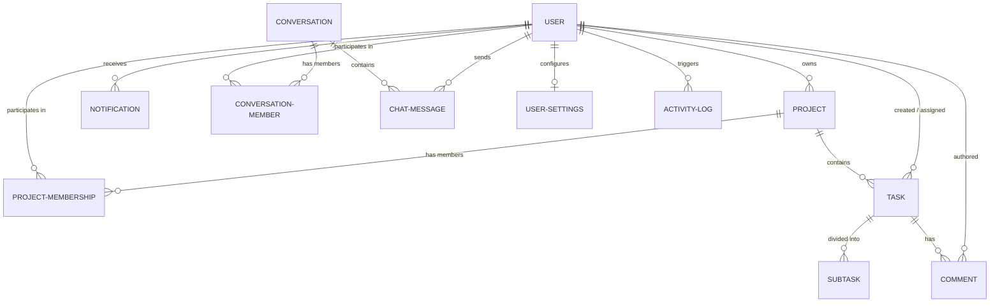

# TaskFlow Database Schema & Architecture

This document describes the relational database schema implemented for **TaskFlow** via the Django Object-Relational Mapper (ORM).

---

## 1. Entity-Relationship Overview

---

## 2. Table Specifications

### 2.1 `core_user` (Custom User Model)
Extends Django's `AbstractUser`, substituting standard username login with unique emails.

| Column | Type | Constraints | Description |
|---|---|---|---|
| `id` | BigAutoField | PRIMARY KEY | Unique user ID |
| `email` | EmailField | UNIQUE, NOT NULL | Primary authentication identifier |
| `username` | CharField(150) | UNIQUE, NOT NULL | Standard Django username fallback |
| `display_name` | CharField(150) | BLANK | User full or chosen display name |
| `job_title` | CharField(100) | DEFAULT 'Team Member' | Professional title / role |
| `department` | CharField(100) | DEFAULT 'General' | Department or squad |
| `bio` | TextField | BLANK | User profile summary / About section |
| `phone` | CharField(30) | BLANK | Contact telephone |
| `location` | CharField(100) | DEFAULT 'Remote' | Location or timezone |
| `avatar_color` | CharField(30) | DEFAULT 'blue' | CSS color accent for initials avatar |
| `profile_picture` | ImageField | NULLABLE | Uploaded avatar photo |
| `created_at` | DateTimeField | AUTO NOW ADD | Timestamp of registration |
| `updated_at` | DateTimeField | AUTO NOW | Timestamp of last modification |

---

### 2.2 `core_project`
Workspaces and project containers for tasks and collaborators.

| Column | Type | Constraints | Description |
|---|---|---|---|
| `id` | BigAutoField | PRIMARY KEY | Unique project ID |
| `name` | CharField(200) | NOT NULL | Project title |
| `description` | TextField | BLANK | Project goals and details |
| `owner_id` | ForeignKey | REFERENCES core_user(id) | Project creator & primary owner |
| `color` | CharField(50) | DEFAULT 'blue' | Color token for tags & cards |
| `status` | CharField(50) | DEFAULT 'Active' | Active, Planning, At Risk, Completed |
| `is_archived` | BooleanField | DEFAULT False | Soft-archive indicator |
| `start_date` | DateField | NULLABLE | Target project start date |
| `due_date` | DateField | NULLABLE | Target delivery / deadline |
| `created_at` | DateTimeField | AUTO NOW ADD | Project creation timestamp |
| `updated_at` | DateTimeField | AUTO NOW | Last update timestamp |

---

### 2.3 `core_projectmembership`
Role-based access control binding users to projects.

| Column | Type | Constraints | Description |
|---|---|---|---|
| `id` | BigAutoField | PRIMARY KEY | Unique membership ID |
| `project_id` | ForeignKey | REFERENCES core_project(id) | Project reference |
| `user_id` | ForeignKey | REFERENCES core_user(id) | User reference |
| `role` | CharField(20) | DEFAULT 'member' | `owner`, `manager`, `member`, `viewer` |
| `joined_at` | DateTimeField | AUTO NOW ADD | Timestamp joined |

*Constraint:* `UNIQUE(project_id, user_id)`

---

### 2.4 `core_task`
Actionable task units organized under projects.

| Column | Type | Constraints | Description |
|---|---|---|---|
| `id` | BigAutoField | PRIMARY KEY | Unique task ID |
| `project_id` | ForeignKey | REFERENCES core_project(id) | Parent project |
| `creator_id` | ForeignKey | REFERENCES core_user(id) | User who created the task |
| `assignee_id` | ForeignKey | REFERENCES core_user(id), NULLABLE | Assigned team member |
| `title` | CharField(255) | NOT NULL | Task title |
| `description` | TextField | BLANK | Rich description / instructions |
| `status` | CharField(50) | DEFAULT 'To Do' | 'To Do', 'In Progress', 'In Review', 'Completed' |
| `priority` | CharField(50) | DEFAULT 'Medium' | 'Low', 'Medium', 'High', 'Urgent' |
| `due_date` | DateField | NULLABLE | Task due date |
| `created_at` | DateTimeField | AUTO NOW ADD | Creation timestamp |
| `updated_at` | DateTimeField | AUTO NOW | Last update timestamp |

---

### 2.5 `core_subtask`
Checklist items breakdown within a task.

| Column | Type | Constraints | Description |
|---|---|---|---|
| `id` | BigAutoField | PRIMARY KEY | Unique subtask ID |
| `task_id` | ForeignKey | REFERENCES core_task(id) | Parent task |
| `title` | CharField(255) | NOT NULL | Checklist item title |
| `is_completed` | BooleanField | DEFAULT False | Completion checkbox status |
| `created_at` | DateTimeField | AUTO NOW ADD | Creation timestamp |

---

### 2.6 `core_comment`
Discussion threads attached to specific tasks.

| Column | Type | Constraints | Description |
|---|---|---|---|
| `id` | BigAutoField | PRIMARY KEY | Unique comment ID |
| `task_id` | ForeignKey | REFERENCES core_task(id) | Target task |
| `author_id` | ForeignKey | REFERENCES core_user(id) | Comment author |
| `content` | TextField | NOT NULL | Comment message text |
| `created_at` | DateTimeField | AUTO NOW ADD | Created timestamp |
| `updated_at` | DateTimeField | AUTO NOW | Last edited timestamp |

---

### 2.7 `core_notification`
Persistent real-time notification records.

| Column | Type | Constraints | Description |
|---|---|---|---|
| `id` | BigAutoField | PRIMARY KEY | Unique notification ID |
| `recipient_id` | ForeignKey | REFERENCES core_user(id) | Target user |
| `actor_id` | ForeignKey | REFERENCES core_user(id), NULLABLE | User who triggered the event |
| `notification_type`| CharField(50)| DEFAULT 'task' | 'task', 'mention', 'comment', 'project' |
| `message` | TextField | NOT NULL | Formatted notification text |
| `related_project_id`| ForeignKey| REFERENCES core_project(id), NULLABLE | Linked project |
| `related_task_id`| ForeignKey | REFERENCES core_task(id), NULLABLE | Linked task |
| `is_read` | BooleanField | DEFAULT False | Read indicator |
| `created_at` | DateTimeField | AUTO NOW ADD | Timestamp triggered |

---

### 2.8 `core_conversation` & `core_chatmessage`
Real-time messaging channels and direct messages.

- **`core_conversation`**: `id`, `title`, `is_group`, `created_at`, `updated_at`
- **`core_conversationmember`**: `id`, `conversation_id`, `user_id`, `last_read_at`
- **`core_chatmessage`**: `id`, `conversation_id`, `sender_id`, `content`, `created_at`

---

## 3. Database Engine Flexibility

- **Local Development & College Submission**: Built and validated with `SQLite3` (`backend/db.sqlite3`).
- **Production / Enterprise Deployment**: Zero code alterations needed for `PostgreSQL`. Simply set `DATABASE_URL` or standard Django database parameters in `backend/.env`.
